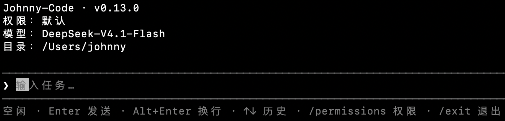

# Johnny-Code

**在终端里读代码、改文件、跑命令的 Coding Agent，用 Go 写成。**


在任意项目目录运行 `johnny`，用自然语言描述任务，它会反复调用文件与命令工具——读实现、改代码、跑测试、查日志——直到给出结论。支持 Anthropic Messages、OpenAI Responses 和 OpenAI Chat Completions 三种协议。



## 特性

- **终端原生 TUI**：流式回复、Markdown 与语法高亮、真实终端光标、中文输入法、工具过程折叠与回看。
- **三种权限模式**：默认逐次审批、只读、放行；审批可只允许本次、本会话内允许或写入项目规则。
- **受控命令执行**：21 个固定查询命令、项目命令前缀、最多 16 段的管道与 `&&`/`||`/`;` 分段器，不经过 shell。
- **后台子 Agent**：`fresh` 或 `fork` 起点，最多 5 个并行；结果自动注入下一轮或唤醒空闲的主 Agent。
- **Workflow**：主 Agent 先声明分步大纲，再逐步并行执行，整步报告合并送回，适合前后依赖的任务。
- **上下文治理**：32 KiB 工具预览、大输出存档、接近窗口时自动压缩，`/context` 与 `/compact` 可查可控。
- **Skills 与长期记忆**：项目/用户级 `SKILL.md`、AGENTS 规则、跨会话 memory，按需加载而非全量注入。
- **可排查**：每轮对话和工具调用写入本地 JSONL，审批原因同样留痕；记录只用于排查，不参与恢复。

## 快速开始

需要 **Go 1.26 或更新版本**，macOS 或 Linux。Windows 需要手动构建，见[开发](docs/development.md)。

```sh
git clone git@github.com:Johnny-Cheung/Johnny-Code.git
cd Johnny-Code
cp .env.example .env      # 填入服务地址、Key 和模型名
./scripts/install.sh
```

安装脚本把程序装到 `GOBIN`（未设置时是 `~/go/bin/johnny`），首次安装会把该目录加入 zsh/Bash 的 PATH。新开终端后：

```sh
cd /path/to/your/project
johnny
```

更新代码后重新执行 `./scripts/install.sh` 即可，`.env` 原地保留、内容不动。

### 配置

```dotenv
JOHNNY_API_KEY=你的 Token
JOHNNY_BASE_URL=https://你的中转站地址
JOHNNY_MODEL=服务提供的模型名
# JOHNNY_API=anthropic-messages   # 可选
```

| 变量 | 说明 |
| --- | --- |
| `JOHNNY_API_KEY` | 以 `Authorization: Bearer` 发送 |
| `JOHNNY_BASE_URL` | 服务根地址或以 `/v1` 结尾的地址；不要填 `/v1/messages` 这类完整接口路径 |
| `JOHNNY_MODEL` | 服务实际提供的模型标识 |
| `JOHNNY_API` | `anthropic-messages`（默认）、`openai-responses`、`openai-chat-completions` |

`.env` 被 Git 忽略，仓库只带 `.env.example`。环境变量按字段优先于文件，`--api` / `--model` 优先于两者。安装脚本把 **clone 目录下 `.env` 的路径**写进二进制，所以 clone 目录不要移动或删除；移动后重新安装即可，也可以完全改用环境变量。

更多配置项、目录和日志说明见[配置](docs/configuration.md)。

## 使用

```sh
johnny           # 默认模式：逐次审批
johnny --read    # 只读模式
johnny --skip    # 放行模式：跳过逐次审批
```


| 模式 | 行为 |
| --- | --- |
| `default` | 工作目录内的文件读写、固定查询命令自动执行；其余操作逐次审批 |
| `read` | 拒绝写入；`bash` 只允许固定查询；不弹审批，直接拒绝 |
| `allow` | 工具直接执行，不逐次确认 |

常用操作：

| 操作 | 行为 |
| --- | --- |
| `Enter` / `Alt+Enter` | 发送任务 / 输入换行 |
| `↑` `↓` | 浏览本次输入历史；斜杠菜单打开时改为选择 |
| `/` | 打开 Skill 与内置命令菜单 |
| `Ctrl+O` | 展开或折叠最近一次工具过程 |
| `Ctrl+C` | 取消本轮和全部子任务；空闲时清空输入 |
| `/exit`、空输入 `Ctrl+D` | 退出 |

内置命令：`/permissions`、`/context`、`/compact`、`/memory`、`/remember`、`/skills`、`/skills reload`、`/skill <name>`。每个 Skill 同时是独立的 `/skill-name` 命令。

完整按键、审批面板和任务区说明见[使用手册](docs/usage.md)。

## 文档

| 文档 | 内容 |
| --- | --- |
| [使用手册](docs/usage.md) | 按键、内置命令、审批、任务区、输出与退出 |
| [配置](docs/configuration.md) | `.env`、协议、环境变量、会话日志与本地目录 |
| [权限模型](docs/permissions.md) | 三种模式、固定查询、分段器、审批与边界 |
| [开发](docs/development.md) | 本地运行、测试、代码结构和手动验证工具 |
| [路线图](docs/johnny-code-roadmap.md) | 版本顺序、范围与各版验收状态 |
| [版本文档](docs/versions/) | v0.1 – v0.13 的设计、取舍和验收记录 |

